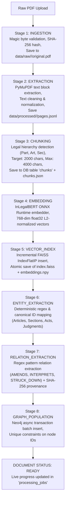
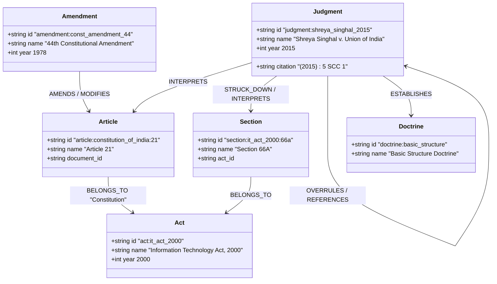
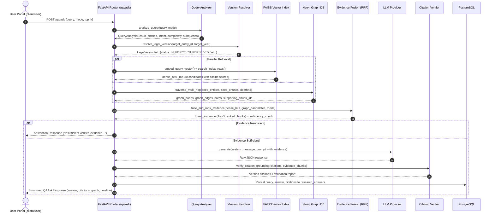

# Software Architecture and Data-Flow Specifications
## Juris AI: GraphRAG-Based Indian Legal Reasoning System
**Document ID:** `reports/project_audit/02_architecture_and_dataflow.md`  
**System Root:** `c:\Projects\Juris AI`  
**Authoritative Evidence:** Codebase inspection of `server/api/app/`, `client/`, `data/`, and `docker-compose.yml`  

---

### 1. Actual System Architecture

Juris AI is designed as a modular, three-tier enterprise architecture separating client presentation, backend application orchestration, and heterogeneous persistent storage engines (relational, property graph, and vector).

```mermaid
flowchart TB
    subgraph ClientTier ["Presentation Layer (Next.js 16 / React 19)"]
        LP["Landing Page (:3000)\nclient/landing"]
        AP["Admin Portal (:3001)\nclient/admin"]
        UP["User Portal (:3002)\nclient/user"]
    end

    subgraph APITier ["Application Layer (FastAPI :8000)\nserver/api/app/"]
        MW["Security Middleware\nSession, RBAC, CSRF, Rate Limit"]
        ROUTER["API Routers\n/qa, /retrieval, /documents, /graph, /auth, /validation, /settings"]
        
        subgraph PipelineSubsystem ["Deterministic GraphRAG Pipeline (app/rag/pipeline.py)"]
            QANODE["1. Query Analysis\napp/rag/query_analysis.py"]
            TEMPNODE["2. Temporal & Version Resolution\napp/rag/temporal.py"]
            RETNODE["3. Parallel Retrieval\nFAISS Dense + Neo4j Cypher"]
            FUSENODE["4. Evidence Fusion & RRF\napp/rag/evidence_fusion.py"]
            PROMPTNODE["5. Prompt Construction\napp/qa/prompts.py"]
            LLMNODE["6. LLM Synthesis & Retry\napp/qa/provider.py"]
            CITENODE["7. Citation Verification\napp/rag/citation_verifier.py"]
            VALNODE["8. Groundedness Validation\napp/rag/validation.py"]
        end
    end

    subgraph IngestionSubsystem ["Offline & Asynchronous Ingestion (app/ingestion/)"]
        EXTRACT["PDF Validator & Extractor\nPyMuPDF / fitz"]
        CHUNKER["Structural Legal Chunker\nHierarchy & Part/Art Boundaries"]
        EMBED["InLegalBERT Embedder\nONNX Runtime (768d)"]
        GRAPHPOP["Entity/Relation Extractor\nRegex & Provenance Keying"]
    end

    subgraph DataTier ["Persistence & Knowledge Layer"]
        PG[("PostgreSQL 16 (:5434/:5432)\nUsers, Audit, Validation, Settings,\nSessions, History, Jobs")]
        NEO[("Neo4j 5 Community (:7687)\n6,135 Nodes, 10,514 Edges\nProvenance-Backed Triples")]
        FAISS[("FAISS Vector Index (Local FS)\nIndexFlatIP, 2,412 x 768d\nembeddings.npy, metadata.json")]
        FS[("Raw Storage Filesystem\ndata/raw, data/processed, data/chunks")]
    end

    %% Client to API
    LP -->|HTTP REST| MW
    AP -->|HTTP REST / Cookies| MW
    UP -->|HTTP REST / Cookies| MW
    MW --> ROUTER

    %% Router to Services
    ROUTER -->|/qa/ask| PipelineSubsystem
    ROUTER -->|/documents/upload| IngestionSubsystem
    ROUTER -->|/auth, /admin, /settings| PG
    ROUTER -->|/graph (Read-Only)| NEO

    %% Ingestion Data Flow
    IngestionSubsystem -->|Raw PDFs & JSONL| FS
    IngestionSubsystem -->|Metadata & Chunks| PG
    IngestionSubsystem -->|Vectors & Index| FAISS
    IngestionSubsystem -->|Nodes & Relations| NEO

    %% Pipeline Data Flow
    QANODE --> TEMPNODE
    TEMPNODE --> RETNODE
    RETNODE -->|Dense Search| FAISS
    RETNODE -->|Cypher Traversal| NEO
    RETNODE --> FUSENODE
    FUSENODE --> PROMPTNODE
    PROMPTNODE --> LLMNODE
    LLMNODE --> CITENODE
    CITENODE --> VALNODE
    VALNODE -->|Persist History| PG
    VALNODE -->|Grounded JSON Response| ROUTER
```

---

### 2. Component Layers & Responsibilities

#### B1. Presentation Layer (`client/`)
- **Framework & Dependencies:** Next.js 16.0.10, React 19.2.0, TailwindCSS v4.1.9, TypeScript 5, Lucide React (`client/admin/package.json:L12-L19`).
- **Application Portals:**
  - **Landing Page (`client/landing`, Port 3000):** Public portal featuring architecture diagrams, feature breakdown, research mode comparisons, and interactive 3D hero canvas powered by Three.js and `@react-three/fiber` (`client/landing/package.json:L40-L42`).
  - **User Portal (`client/user`, Port 3002):** Research workspace providing query input, Research Mode selection (`COMPREHENSIVE`, `CONSTITUTIONAL`, `STATUTORY`, `CASE_LAW`), interactive SVG Knowledge Graph visualization (`client/user/components/research/KnowledgeGraphTab.tsx`), grounded answer inspector with citation popovers, legal timeline view, research session history, and bookmark manager.
  - **Admin Portal (`client/admin`, Port 3001):** Operational dashboard tracking document ingestion states (`PENDING`, `RUNNING`, `COMPLETED`, `FAILED`), raw PDF document upload, chunk inspector, Neo4j Graph Explorer with multi-hop neighbor browsing, human-in-the-loop entity validation queue, audit logs, user role assignment (`USER`, `ADMIN`, `SUPER_ADMIN`), and system configuration editor (`client/admin/app/admin/(app)/page.tsx`).
- **Communication Protocol:** JSON over HTTP REST. Authentication session tokens are transmitted strictly via HttpOnly, SameSite cookies (`juris_portal_session`), ensuring protection against client-side script token exfiltration (`server/api/app/core/session.py:L14-L62`).

#### B2. API and Application Layer (`server/api/app/`)
- **Framework:** FastAPI 0.115.x on Python 3.12, running under Uvicorn (`server/api/pyproject.toml:L10-L21`).
- **API Entry Point:** `server/api/app/main.py:L57-L144` defines application routers and sets the Windows Selector event loop policy (`asyncio.WindowsSelectorEventLoopPolicy()`) on Windows systems to eliminate `psycopg` Proactor event loop errors (`server/api/app/main.py:L9-L10`).
- **Middleware Stack:**
  1. `RateLimitMiddleware` (`server/api/app/core/rate_limit.py`): In-memory per-IP token bucket rate limiting (30 auth/min, 30 qa/min, 20 upload/min).
  2. `CSRFMiddleware` (`server/api/app/core/csrf.py`): Double-submit cookie CSRF validation for mutating endpoints.
  3. `PortalSessionMiddleware` (`server/api/app/core/session.py`): Signed session cookies with portal identification (`user` vs `admin`) preventing cross-portal privilege escalation.
  4. `CORSMiddleware`: Strict origin allowlisting supporting local development ports (3000, 3001, 3002, 5173) and production Vercel domains (`server/api/app/main.py:L68-L111`).
- **Implemented API Routes:**
  - Health checks: `GET /health`, `GET /health/ready`, `GET /health/live`, `GET /health/detailed` (`app/api/routes/health.py`).
  - Authentication & OAuth: `GET /auth/me`, `POST /auth/login`, `POST /auth/logout`, `GET /auth/google`, `GET /auth/google/callback` (`app/api/routes/auth.py`).
  - Legal QA & Research: `POST /qa/ask`, `POST /qa/feedback` (`app/api/routes/qa.py`).
  - Vector Retrieval: `POST /retrieval/search` (`app/api/routes/retrieval.py`).
  - Knowledge Graph: `GET /graph/search`, `GET /graph/nodes/{id}`, `GET /graph/neighbors/{id}`, `GET /graph/subgraph` (`app/api/routes/graph.py`).
  - Document Management: `GET /documents`, `POST /documents/upload`, `GET /documents/{id}`, `POST /documents/{id}/reprocess`, `DELETE /documents/{id}` (`app/api/routes/documents.py`).
  - Admin & RBAC: `GET /admin/users`, `POST /admin/admins`, `PATCH /admin/users/{id}/role` (`app/api/routes/admin_users.py`).
  - Validation Queue: `GET /validation`, `POST /validation/{id}/approve`, `POST /validation/{id}/reject` (`app/api/routes/validation.py`).
  - Audit Logs: `GET /audit`, `GET /audit/{id}` (`app/api/routes/audit.py`).
  - System Settings: `GET /settings`, `PUT /settings/{section}` (`app/api/routes/settings.py`).
  - Research History & Saved: `GET /history`, `GET /saved` (`app/api/routes/history.py`, `app/api/routes/saved_research.py`).
  - Automated Evaluation: `POST /evaluation/run`, `GET /evaluation/runs` (`app/api/routes/evaluation.py`).

---

### 3. Legal Document Ingestion Pipeline (`server/api/app/ingestion/`)

The ingestion subsystem processes raw legal PDF documents through an 8-stage state-tracked pipeline (`server/api/app/ingestion/pipeline.py:L134-L470`):



#### Detailed Stage Specifications
1. **Stage 1 (INGESTION):** Verifies PDF magic bytes (`%PDF-`), computes SHA-256 checksum for deduplication, rejects zero-byte or corrupt PDFs, and saves raw bytes to `data/raw/<document_id>/original.pdf` (`app/ingestion/validator.py:L26-L78`).
2. **Stage 2 (EXTRACTION):** Employs PyMuPDF (`fitz`) to extract page-by-page text. Text normalizer cleans CRLF line breaks, merges hyphenated line breaks (`con-\nstitution` $\rightarrow$ `constitution`), collapses superfluous whitespace, and preserves legal proviso boundaries (`Provided that...`) (`app/ingestion/extractor.py`, `app/ingestion/normalizer.py`).
3. **Stage 3 (CHUNKING):** Detects structural legal boundaries using regular expressions for `PART`, `CHAPTER`, `SCHEDULE`, `ARTICLE`, `SECTION`, `SUBSECTION`, `CLAUSE`, and `PROVISO`. Chunks are bounded between 2,000 target characters and 4,000 maximum characters with 200 characters of overlap. Chunks are persisted to PostgreSQL (`chunks` table) and filesystem (`data/chunks/<document_id>/chunks.json`) (`app/ingestion/chunker.py:L18-L145`).
4. **Stage 4 (EMBEDDING):** Passes chunk texts through `OnnxInLegalBertEmbedder` (or PyTorch fallback) in batches of 16. Single-threaded CPU execution is enforced (`OMP_NUM_THREADS=1`, `MKL_NUM_THREADS=1`) to prevent CPU thread starvation (`app/retrieval/embeddings.py:L11-L18`).
5. **Stage 5 (VECTOR_INDEX):** Updates the FAISS index incrementally using `update_index_incremental`. If chunks for the document previously existed, old vectors are filtered out before appending new ones to guarantee idempotency. Persistent artifacts (`index.faiss`, `embeddings.npy`, `metadata.json`) are written atomically via temporary files (`app/retrieval/index.py:L106-L180`).
6. **Stage 6 (ENTITY_EXTRACTION):** Applies deterministic legal extraction rules across chunk texts to identify canonical entities: `article:constitution_of_india:<number>`, `section:<act_id>:<number>`, `act:<canonical_name>`, `judgment:<name>`, `court:<name>`, `amendment:<id>`, `doctrine:<name>` (`app/graph/extraction.py:L14-L245`).
7. **Stage 7 (RELATION_EXTRACTION):** Detects semantic relationships between entities co-occurring in the chunk or linked through explicit phrasing (`AMENDS`, `MODIFIES`, `SUPERSEDES`, `STRUCK_DOWN`, `INTERPRETS`, `DEFINES`, `REFERENCES`, `CITES`, `OVERRULES`, `BELONGS_TO`). Each relationship is assigned a SHA-256 `provenance_key` derived from `source_document_id`, `source_chunk_id`, and `evidence_text` (`app/graph/extraction.py:L248-L410`).
8. **Stage 8 (GRAPH_POPULATION):** Compiles the entity-relationship payload and executes parameterized Cypher `MERGE` transactions against Neo4j via `Neo4jClient.replace_document_graph` (`app/graph/population.py:L14-L125`).

---

### 4. Semantic Encoding & Dense Vector Index

#### Model Configuration
- **Model Checkpoint:** `law-ai/InLegalBERT` (`server/api/app/core/config.py:L129`).
- **Tokenizer:** Hugging Face `AutoTokenizer.from_pretrained("law-ai/InLegalBERT")`.
- **Input Limit:** Max token length truncated to 512 tokens (`embedding_max_tokens = 512`).
- **Pooling Method:** **Attention-mask-aware mean pooling** over final hidden states:
  $$\mathbf{u} = \frac{\sum_{i=1}^{L} m_i \mathbf{h}_i}{\sum_{i=1}^{L} m_i}$$
  where $m_i \in \{0, 1\}$ is the attention mask bit and $\mathbf{h}_i \in \mathbb{R}^{768}$ is the hidden representation of token $i$ (`server/api/app/retrieval/embeddings.py:L110-L112`).
- **Vector Normalization:** Strict $L_2$ Euclidean normalization:
  $$\mathbf{v} = \frac{\mathbf{u}}{\max(\|\mathbf{u}\|_2, 10^{-12})}$$
  Ensures that the dot product between any two vectors equals their cosine similarity (`embeddings.py:L113-L114`).
- **Inference Runtime:** Primary: ONNX Runtime CPU (`OnnxInLegalBertEmbedder`, model file: `data/models/inlegalbert/model.onnx`, 435 MB; INT8 quantized: `model_int8.onnx`, 109 MB). Fallback: PyTorch CPU (`InLegalBertEmbedder`).

#### FAISS Vector Index
- **Index Type:** `faiss.IndexFlatIP` (Exact Inner Product Search) over 768-dimensional float32 vectors (`app/retrieval/index.py:L47-L48`).
- **Mathematical Search Property:** Because vectors are $L_2$-normalized, `IndexFlatIP.search()` computes **exact cosine similarity** without quantization or clustering approximation errors:
  $$\langle \mathbf{q}, \mathbf{d} \rangle = \cos(\mathbf{q}, \mathbf{d}) \in [-1.0, 1.0]$$
- **Persisted Artifacts:**
  - `data/indexes/legal_chunks/index.faiss`: Serialized FAISS index (7,409,709 bytes).
  - `data/indexes/legal_chunks/embeddings.npy`: Binary matrix of 2,412 rows $\times$ 768 float32 columns (7,409,792 bytes).
  - `data/indexes/legal_chunks/metadata.json`: JSON metadata mapping FAISS row `0..2411` directly to `chunk_id`, `document_id`, `page_start`, `page_end`, `hierarchy`, and document title (17,566,040 bytes).

---

### 5. Knowledge Graph Architecture (`server/api/app/graph/`)

#### Ontology & Property Graph Schema
The Neo4j database organizes the legal corpus into 14 node entity types and 10 canonical relationship types:



- **Node Identity Constraints:** Uniqueness constraints enforced in Neo4j on `n.id` across all labels (`server/api/app/graph/client.py:L106-L122`).
- **Relationship Provenance Attributes:** Every edge retains mandatory audit properties:
  `provenance_key` (SHA-256 hash), `source_document_id`, `source_chunk_id`, `page_start`, `page_end`, `evidence_text`, `confidence`, `extraction_method` (`server/api/app/graph/extraction.py:L402-L410`).

#### Multi-Hop Traversal Engine (`app/graph/traversal.py`)
- **Query Algorithm:** Executes bounded Cypher path matching starting from seed entities or seed chunk IDs:
  ```cypher
  MATCH p=(seed)-[rels*1..{hops}]-(target)
  WHERE seed.id IN $seed_ids
    AND ALL(x IN nodes(p) WHERE single(y IN nodes(p) WHERE y = x))
  LIMIT $limit
  RETURN nodes(p) AS path_nodes, relationships(p) AS path_relationships
  ```
- **Depth & Node Bounds:** Default traversal depth: 3 hops. Hard maximum: 5 hops. Maximum candidate node limit: 30 to 50 nodes.
- **Cycle Prevention:** Cypher clause `ALL(x IN nodes(p) WHERE single(y IN nodes(p) WHERE y = x))` enforces simple paths without cycles.
- **2D UI Layout Computation:** `compute_node_layout()` computes deterministic SVG $(x, y)$ coordinates for the client visualization tab (`app/graph/traversal.py:L85-L130`).

---

### 6. GraphRAG Query Execution Flow (`server/api/app/rag/pipeline.py`)

The query processing pipeline coordinates 8 sequential stages:



#### Step-by-Step Execution Mechanics
1. **Query Analysis (`app/rag/query_analysis.py`):** Normalizes the input query, extracts legal entities via regex patterns, determines retrieval intent (`STATUTORY_INTERPRETATION`, `CONSTITUTIONAL_VALIDITY`, `PRECEDENT_ANALYSIS`, `TEMPORAL_EVOLUTION`), and generates subqueries for multi-query expansion.
2. **Temporal & Legal Version Resolution (`app/rag/temporal.py`):** Analyzes whether the query specifies temporal constraints (`BEFORE`, `AFTER`, explicit years like 1978). Resolves entity status against landmark amendment milestones.
3. **Dense Vector Search (`app/retrieval/index.py`):** Generates a 768-dim query embedding using InLegalBERT and retrieves the top 30 candidate chunks from FAISS. If subqueries were generated, their embeddings are also queried, and results are blended via Reciprocal Rank Fusion ($k=60$).
4. **Multi-Hop Graph Traversal (`app/graph/traversal.py`):** Queries Neo4j using detected entities and top chunk IDs as seeds. Traverses relationships up to depth 3, retrieving path bridges and connected legal entities. If Neo4j is unreachable, the engine gracefully catches the error and sets `fallback="dense_only"`.
5. **Evidence Fusion & Ranking (`app/rag/evidence_fusion.py`):** Combines dense vector candidates and graph candidates using weighted Reciprocal Rank Fusion:
   $$\text{Score}(c) = w_{\text{vector}} \cdot S_{\text{vector}}(c) + w_{\text{graph}} \cdot S_{\text{graph}}(c)$$
   Applies Research Mode multipliers: `CONSTITUTIONAL` ($1.25\times$), `STATUTORY` ($1.25\times$), `CASE_LAW` ($1.30\times$). Applies context budgeting (maximum 2 chunks per document page to avoid local concentration).
6. **Evidence Sufficiency Evaluation:** Evaluates whether retrieved chunks contain required entities. If insufficient, immediately returns a grounded abstention message without incurring LLM cost or risking hallucination.
7. **LLM Synthesis & Retry Loop (`app/qa/provider.py`):** Formats evidence blocks with markers `[1]`, `[2]`. Prompts the LLM with strict instructions forbidding external facts. If output parsing fails or citations cannot be mapped, initiates an automated self-correction prompt (max 2 attempts).
8. **Citation Verification (`app/rag/citation_verifier.py`):** Parses citation strings (SCC, AIR, Article, Section) and validates them directly against source document titles, chunk IDs, and page ranges.
9. **Persistence & Return:** Saves the interaction to PostgreSQL (`research_queries`, `research_answers`, `citations`) and returns a structured `QAAskResponse` containing answer text, verified citations, SVG graph coordinates, reasoning trace, and timeline events.

---

### 7. Deployment and Storage Architecture

- **Container Configuration (`docker-compose.yml`):**
  - `postgres`: PostgreSQL 16 Alpine running on host port `5434` (mapped to internal `5432`), mounted to named volume `pgdata`.
  - `neo4j`: Neo4j 5 Community running on HTTP port `7474` and Bolt port `7687`, mounted to named volume `neo4jdata`.
  - `api`: FastAPI application container built via `server/api/Dockerfile` on Python 3.12-slim.
- **Microservice Extension (`embedding-service/`):** A standalone FastAPI microservice (`embedding-service/app/main.py`) provides decoupled embedding generation via HTTP POST `/embed`, preserving exact attention-mask mean pooling and $L_2$ normalization for distributed deployments.
- **Production Cloud Footprint:**
  - Backend API: Dockerized on Linux container host (Render / Azure App Service).
  - Client Portals: Next.js edge builds hosted on Vercel (`juris-ai-user.vercel.app`, `juris-ai-admin.vercel.app`, `juris-ai-landing-ten.vercel.app`).
  - Graph Store: Neo4j 5 Community / AuraDB instance accessed via secure Bolt connection.
