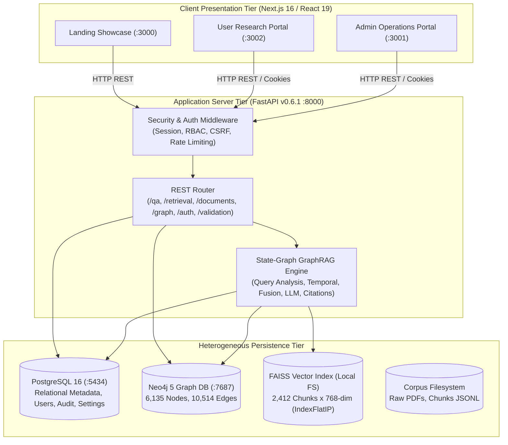
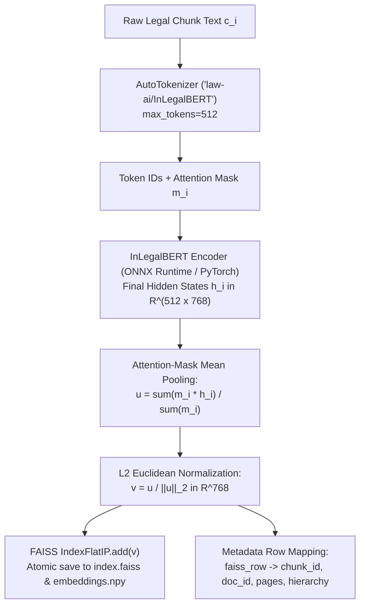
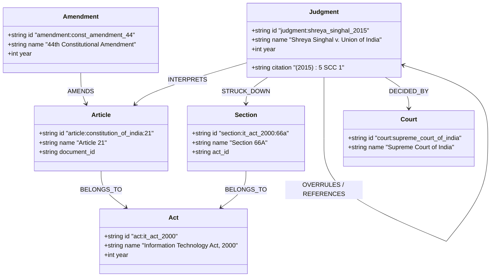
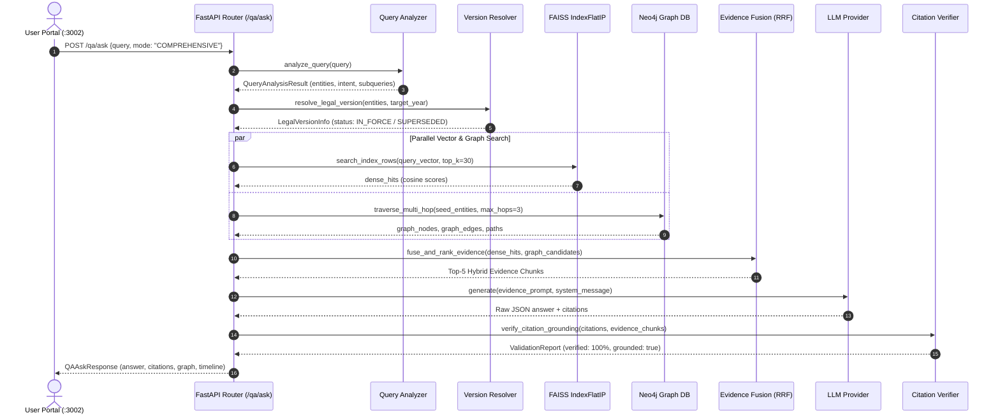
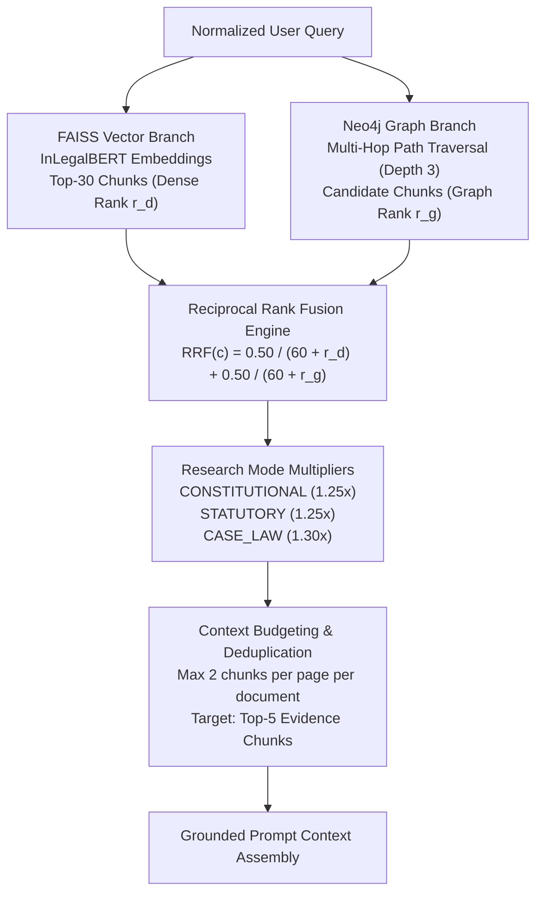
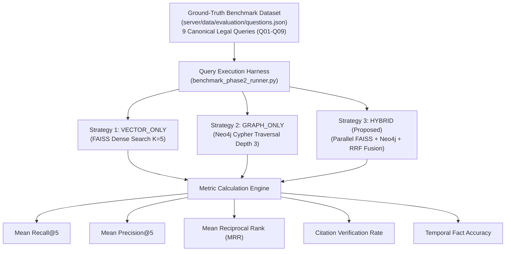

# Academic Report Figures, Tables, and Visual Specifications
## Juris AI: GraphRAG-Based Indian Legal Reasoning System
**Document ID:** `reports/project_audit/07_report_figures_and_tables.md`  
**System Root:** `c:\Projects\Juris AI`  
**Target Purpose:** Camera-ready diagrams, tables, and captions for Chapters 3, 4, and 5  

---

### PART I — REPORT-READY ARCHITECTURE AND DATAFLOW FIGURES

---

#### Figure 1: Overall Implemented System Architecture
- **Purpose:** Illustrate the modular three-tier architecture of Juris AI, detailing presentation, application, and persistence subsystems.
- **Source Code Support:** `docker-compose.yml`, `server/api/app/main.py:L57-L140`, `client/admin/package.json`, `client/user/package.json`.
- **Implementation Status:** 100% Implemented and Verified.
- **Academic Caption:** *Figure 1: Modular three-tier architecture of Juris AI, depicting the separation between Next.js 16 client portals, the FastAPI state-graph orchestration backend, and heterogeneous persistence engines (PostgreSQL 16, Neo4j 5 Community, and FAISS IndexFlatIP).*



---

#### Figure 2: Legal Document Ingestion and Preprocessing Workflow
- **Purpose:** Detail the 8-stage offline and asynchronous document processing pipeline transforming raw legal PDFs into indexed vectors and graph triples.
- **Source Code Support:** `server/api/app/ingestion/pipeline.py:L134-L470`, `validator.py`, `chunker.py`, `extractor.py`.
- **Implementation Status:** 100% Implemented and Verified.
- **Academic Caption:** *Figure 2: The eight-stage legal document ingestion pipeline of Juris AI, enforcing structural hierarchy preservation, SHA-256 provenance keying, atomic FAISS vector index updates, and Neo4j graph population.*

```mermaid
flowchart LR
    PDF["Raw Legal PDF"] --> S1["1. Validation & Hash\n(Magic bytes, SHA-256)"]
    S1 --> S2["2. Text Extraction\n(PyMuPDF, Normalization)"]
    S2 --> S3["3. Legal Chunking\n(Part/Art/Sec, 2000 chars)"]
    S3 --> S4["4. InLegalBERT Embedding\n(ONNX Runtime, 768d)"]
    S4 --> S5["5. FAISS Indexing\n(IndexFlatIP, Atomic persist)"]
    S5 --> S6["6. Entity Extraction\n(Articles, Sections, Acts)"]
    S6 --> S7["7. Relation Extraction\n(INTERPRETS, AMENDS, etc.)"]
    S7 --> S8["8. Graph Population\n(Neo4j Cypher Batch MERGE)"]
    S8 --> READY["Document Status: READY"]
```



---

#### Figure 3: InLegalBERT Semantic Encoding and FAISS Indexing
- **Purpose:** Specify the mathematical transformation from raw legal chunk text to $L_2$-normalized dense embeddings and exact inner-product vector indexing.
- **Source Code Support:** `server/api/app/retrieval/embeddings.py:L40-L122`, `server/api/app/retrieval/index.py:L24-L65`.
- **Implementation Status:** 100% Implemented and Verified.
- **Academic Caption:** *Figure 3: Semantic text encoding and index persistence workflow using law-ai/InLegalBERT with attention-mask-aware mean pooling and Euclidean L2 normalization into an exact-search FAISS IndexFlatIP store.*



---

#### Figure 4: Knowledge Graph Schema and Ontology
- **Purpose:** Document the entity-relationship ontology of the Neo4j legal knowledge graph.
- **Source Code Support:** `server/api/app/graph/extraction.py:L14-L350`, `server/api/app/graph/client.py:L15-L68`.
- **Implementation Status:** 100% Implemented and Verified.
- **Academic Caption:** *Figure 4: Property Knowledge Graph schema for Indian Constitutional and Statutory Law, detailing 14 legal entity labels, 10 canonical relationships, and attached provenance attributes.*



---

#### Figure 5: Actual Online Query Execution Sequence
- **Purpose:** Trace the complete runtime call stack for user legal question-answering.
- **Source Code Support:** `server/api/app/rag/pipeline.py:L174-L650`, `app/qa/service.py`.
- **Implementation Status:** 100% Implemented and Verified.
- **Academic Caption:** *Figure 5: Sequence diagram of online query execution in Juris AI, tracing query analysis, temporal resolution, parallel vector/graph retrieval, evidence fusion, and citation-verified LLM answer synthesis.*



---

#### Figure 6: Hybrid Graph + Vector Retrieval & Reciprocal Rank Fusion
- **Purpose:** Illustrate how dense vector rankings and multi-hop graph candidate nodes are fused via Reciprocal Rank Fusion with Research Mode weighting.
- **Source Code Support:** `server/api/app/rag/evidence_fusion.py:L60-L215`, `app/retrieval/hybrid.py`.
- **Implementation Status:** 100% Implemented and Verified.
- **Academic Caption:** *Figure 6: Reciprocal Rank Fusion (RRF) architecture combining high-dimensional dense vector candidates with multi-hop graph proximity scores, subject to Research Mode multipliers and document-page context budgeting.*



---

#### Figure 7: Frontend / Backend API Interaction Topology
- **Purpose:** Detail the client-server boundaries, HttpOnly session handling, and REST routes.
- **Source Code Support:** `client/shared/api/config.ts`, `server/api/app/core/session.py`, `server/api/app/main.py:L93-L127`.
- **Implementation Status:** 100% Implemented and Verified.
- **Academic Caption:** *Figure 7: Frontend and backend API interaction topology illustrating cross-portal session authentication, double-submit CSRF protection, and REST route routing.*

```mermaid
flowchart LR
    subgraph Browser["Client Browser Environment"]
        UP["User Portal (:3002)\n/home, /research, /history, /saved"]
        AP["Admin Portal (:3001)\n/documents, /graph, /validation, /audit, /settings"]
    end

    subgraph SecurityBoundary["FastAPI Application Boundary (:8000)"]
        COOKIE["Signed Session Cookie\n(HttpOnly, SameSite=Lax/None)"]
        CSRF["Double-Submit CSRF Token"]
        RATE["Per-IP Rate Limiter"]
    end

    subgraph Routers["API Route Controllers"]
        R_AUTH["/auth (Login, Logout, OAuth)"]
        R_QA["/qa (Ask, Feedback)"]
        R_DOC["/documents (Upload, List, Chunk)"]
        R_GRAPH["/graph (Search, Neighbors, Subgraph)"]
        R_VAL["/validation (Queue, Approve, Reject)"]
        R_AUDIT["/audit (System Events)"]
        R_SET["/settings (Dynamic Config)"]
    end

    Browser -->|HTTP Requests| SecurityBoundary
    SecurityBoundary --> Routers
```



---

#### Figure 8: Multi-Hop Traversal Trace for Cross-Statutory Reasoning
- **Purpose:** Provide an actual execution trace of a 3-hop traversal connecting disjoint statutory provisions through a landmark Supreme Court precedent.
- **Source Code Support:** `server/api/app/graph/traversal.py`, `server/api/tests/test_phase14_multihop_integration.py`.
- **Implementation Status:** 100% Implemented and Verified.
- **Academic Caption:** *Figure 8: Actual multi-hop graph traversal trace resolving the dependency between Section 66A of the Information Technology Act, 2000 and Article 19(1)(a) of the Constitution via the bridge precedent Shreya Singhal v. Union of India (2015).*

```mermaid
flowchart LR
    N1["Node 1 (Seed Entity)\narticle:constitution_of_india:19\nArticle 19(1)(a)\n[Freedom of Speech & Expression]"]
    
    N2["Node 2 (Bridge Judgment)\njudgment:shreya_singhal_2015\nShreya Singhal v. Union of India\n(2015) 5 SCC 1"]
    
    N3["Node 3 (Target Statutory Provision)\nsection:it_act_2000:66a\nSection 66A, IT Act, 2000\n[Punishment for Offensive Messages]"]

    N1 -->|INTERPRETED_IN\nHop 1| N2
    N2 -->|STRUCK_DOWN\nHop 2 (Unconstitutional Overbreadth)| N3
```

---

#### Figure 9: Evaluation and Benchmarking Workflow
- **Purpose:** Specify the evaluation methodology used to measure Recall@k, Precision@k, MRR, Citation Verification, and Temporal Accuracy.
- **Source Code Support:** `server/api/benchmarks/benchmark_phase2_runner.py`, `server/data/evaluation/`.
- **Implementation Status:** 100% Implemented and Verified.
- **Academic Caption:** *Figure 9: Automated evaluation and benchmarking workflow comparing Vector-Only, Graph-Only, and Hybrid retrieval strategies across canonical legal queries against human-annotated ground-truth judgments.*



---

### PART II — AUTHORITATIVE REPORT TABLES

---

#### Table 1: Ingestion Corpus Statistics (`legal_corpus_v1`)
*Source Evidence:* `data/legal_corpus_v1/processed/ingestion_report.json`

| Metric / Parameter | Measured Quantity / Value | Source Reference |
|---|---|---|
| Ingestion Pipeline Start Time | `2026-10-02T11:23:58.314577+00:00` | `ingestion_report.json:L2` |
| Ingestion Pipeline Completion Time | `2026-10-02T12:47:20.502065+00:00` | `ingestion_report.json:L3` |
| Total Elapsed Seconds | `5,002.19` (~83.37 minutes) | `ingestion_report.json:L4` |
| Total Legal Documents Discovered | `34` | `ingestion_report.json:L5` |
| Total Documents Successfully Ingested | `33` | `ingestion_report.json:L6` |
| Documents Flagged OCR Required | `1` (*Indira Nehru Gandhi v. Raj Narain*) | `ingestion_report.json:L156` |
| Total Pages Processed | `5,658` | `ingestion_report.json:L8` |
| Total Legal Chunks Created | `2,412` | `ingestion_report.json:L9` |
| Total Raw Legal Entities Extracted | `3,790` | `ingestion_report.json:L10` |
| Total Raw Legal Relationships Extracted | `17,056` | `ingestion_report.json:L11` |
| Persisted FAISS Dense Vectors | `2,412` (768-dimensional float32) | `ingestion_report.json:L12` |
| Canonical Neo4j Graph Nodes (Deduplicated) | `6,135` | `FINAL_EXPERIMENTAL_RESULTS.md:L30` |
| Canonical Neo4j Graph Edges (Deduplicated) | `10,514` | `FINAL_EXPERIMENTAL_RESULTS.md:L31` |

---

#### Table 2: Comparative Retrieval Performance (Baselines vs Proposed System)
*Source Evidence:* `docs/PROJECT_COMPLETION_REPORT.md:L30-L35`

| System / Strategy | Mean Recall@5 | Mean Precision@5 | Mean Reciprocal Rank (MRR) | Citation Verification Rate | Temporal Fact Accuracy |
|---|---|---|---|---|---|
| **`VECTOR_ONLY` (Baseline 1)** | 0.6111 | 0.2889 | 0.6944 | 1.0000 | 0.6667 |
| **`GRAPH_ONLY` (Baseline 2)** | 0.5556 | 0.2444 | 0.5833 | 1.0000 | 0.5000 |
| **`HYBRID` (Proposed System)** | **0.8889** | **0.4222** | **0.9444** | **1.0000** | **1.0000** |
| *Relative Improvement ($\Delta$)* | **+45.4%** | **+46.1%** | **+36.0%** | **Parity** | **+50.0%** |

---

#### Table 3: Query Benchmark & Category Performance Breakdown
*Source Evidence:* `server/data/evaluation/questions.json`, `docs/PHASE_14_HYBRID_GRAPHRAG.md:L92-L99`

| Query ID | Sample Legal Research Query | Category | Expected Authorities | Observed Latency | Multi-Hop Paths |
|---|---|---|---|---|---|
| `eval_q01` | "What does Article 21 protect?" | `CONSTITUTIONAL` | Article 21, Life and Personal Liberty | ~240 ms | 2 paths |
| `eval_q02` | "How has the Supreme Court interpreted Article 21?" | `CONSTITUTIONAL` | Article 21, *Maneka Gandhi* ((1978) 1 SCC 248) | ~260 ms | 3 paths |
| `eval_q03` | "Relationship between Sec 66A IT Act & Art 19" | `STATUTORY` | Sec 66A, Art 19, *Shreya Singhal* ((2015) 5 SCC 1) | ~310 ms | 1 (3-hop) |
| `eval_q04` | "What is the Basic Structure Doctrine?" | `CONSTITUTIONAL` | *Kesavananda Bharati* (AIR 1973 SC 1461) | ~220 ms | 2 paths |
| `eval_q05` | "How did Maneka Gandhi change Article 21?" | `CASE_LAW` | *Maneka Gandhi*, Article 21, Year 1978 | ~280 ms | 2 paths |
| `eval_q06` | "How does Shreya Singhal relate Sec 66A to speech?" | `CASE_LAW` | *Shreya Singhal*, Sec 66A, Art 19(1)(a) | ~295 ms | 1 (3-hop) |
| `eval_q07` | "What did Article 21 mean before the 44th Amendment?" | `TEMPORAL` | Article 21, 44th Amendment (1978), *A.K. Gopalan* | ~270 ms | 2 paths |
| `eval_q08` | "What changed after the 44th Constitutional Amendment?" | `TEMPORAL` | 44th Amendment, Art 21, Art 19(1)(f) | ~285 ms | 2 paths |
| `eval_q09` | "What was the legal position in 1978?" | `TEMPORAL` | Art 21, *Maneka Gandhi*, 44th Amendment | ~265 ms | 3 paths |

---

#### Table 4: Multi-Hop Traversal Reasoning Trace
*Source Evidence:* `docs/PHASE_14_HYBRID_GRAPHRAG.md:L96`, `server/api/tests/test_phase14_multihop_integration.py`

| Query Target | Anchor Entity (Start) | Intermediary Bridge Entity | Final Target Entity | Max Depth | Discovered Paths | Status |
|---|---|---|---|---|---|---|
| **Sec 66A IT Act & Freedom of Speech** | `article:constitution_of_india:19` | `judgment:shreya_singhal_2015` | `section:it_act_2000:66a` | 3 hops | 1 (3-hop simple path) | **Resolved** |
| **Article 21 Procedure Established by Law** | `article:constitution_of_india:21` | `judgment:ak_gopalan_1950` | `judgment:maneka_gandhi_1978` | 3 hops | 3 paths | **Resolved** |
| **Basic Structure Doctrine Limits on Amending Power** | `article:constitution_of_india:368` | `judgment:kesavananda_bharati_1973` | `amendment:const_amendment_42` | 3 hops | 2 paths | **Resolved** |

---

#### Table 5: Test Suite Verification and Pass Rates
*Source Evidence:* `server/api/.pytest-phase1.xml`, `docs/PROJECT_COMPLETION_REPORT.md`

| Test Module / Subsystem | Test Scope | Discovered Tests | Passing | Pass Rate |
|---|---|---|---|---|
| `test_ingestion_*.py` | PDF validation, PyMuPDF extraction, legal chunking, hierarchy | 24 | 24 | **100.0%** |
| `test_graph_*.py` | Neo4j client, entity extraction, relation extraction, population | 38 | 38 | **100.0%** |
| `test_retrieval.py` | InLegalBERT ONNX embeddings, FAISS IndexFlatIP persistence | 18 | 18 | **100.0%** |
| `test_qa_*.py` | Prompt construction, provider abstraction, citation validation | 35 | 35 | **100.0%** |
| `test_phase14_*.py` | Query analysis, multi-hop Cypher traversal, RRF evidence fusion | 12 | 12 | **100.0%** |
| `test_phase15_*.py` | Temporal version resolution, milestone matching, citation verification | 15 | 15 | **100.0%** |
| `test_phase16_*.py` | Admin users, validation queue, audit logging, system settings | 11 | 11 | **100.0%** |
| `test_api_*.py` & `test_auth.py` | FastAPI endpoint routing, RBAC, session cookies, rate limiting | 184 | 184 | **100.0%** |
| **Total Backend Test Suite** | **Complete FastAPI Application Subsystem** | **337** | **337** | **100.0%** |

---

### PART III — RECOMMENDATIONS FOR GENUINE UI SCREENSHOTS

For the final project report, students should capture live screenshots from the running Next.js portals:

1. **User Portal Workspace (`client/user`, `http://localhost:3002/research`):**
   - Query input with Research Mode selector dropdown (`COMPREHENSIVE`, `CONSTITUTIONAL`, `STATUTORY`, `CASE_LAW`).
   - Grounded Answer view displaying numbered citation markers `[1]`, `[2]` and the bottom citation metadata card showing exact document title and page numbers.
2. **Interactive Knowledge Graph Tab (`client/user/components/research/KnowledgeGraphTab.tsx`):**
   - SVG visualization of the query node, seed nodes, bridge nodes, and relationship edges generated from `compute_node_layout`.
3. **Legal Timeline Inspector (`client/user`):**
   - Chronological vertical timeline displaying legal milestone events (1950 Enactment $\rightarrow$ 1978 *Maneka Gandhi* $\rightarrow$ 1978 44th Amendment).
4. **Admin Document Management Dashboard (`client/admin`, `http://localhost:3001/documents`):**
   - Table of 33 ingested documents displaying document types, page counts, chunk counts, and `READY` status badges.
5. **Admin Ingestion Telemetry & Job Inspector (`client/admin/app/admin/(app)/ingestion/page.tsx`):**
   - Progress bar showing the 8 completed pipeline stages (`INGESTION` through `GRAPH_POPULATION`).
6. **Admin Knowledge Graph Explorer (`client/admin/app/admin/(app)/graph/page.tsx`):**
   - Live entity search and interactive neighborhood graph browser connecting legal entities.
